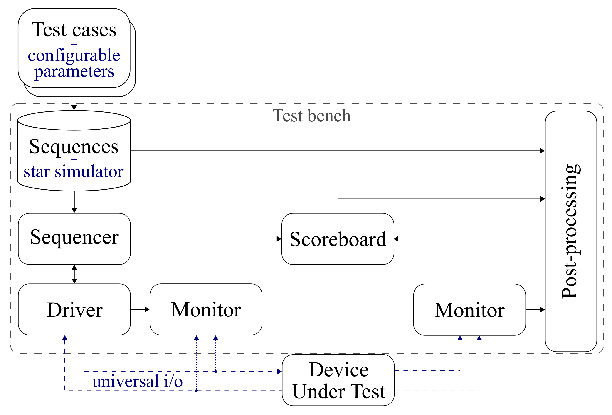

# Verification Platform for Star Trackers

A comprehensive verification platform for testing star tracker algorithms, built using the Universal Verification Methodology (UVM) with SystemC. This platform enables rigorous testing and validation of star tracker designs through simulation and automated verification processes.


*Figure: Structure of the verification platform following UVM nomenclature, with specialized blocks for star tracker verification.*

## About This Repository

This repository contains the verification platform as described in the following research paper:

> Schulz, V. H., Marcelino, G. M., Seman, L. O., Santos Barros, J., Kim, S., Cho, M., Villarrubia González, G., Leithardt, V. R. Q., & Bezerra, E. A. (2021). Universal Verification Platform and Star Simulator for Fast Star Tracker Design. *Sensors*, 21(3), 907. https://doi.org/10.3390/s21030907

**📚 Please cite this paper if this verification platform is useful for your research.**

### Repository Status

⚠️ **This repository is archived** to preserve the exact functionality and implementation described in the research paper above.

### Newer Version Available

For ongoing development and reduced dependencies, please consider using the newer version of the verification platform:

**[Simplified Verification Platform for Star Trackers](https://github.com/schulz89/Simplified-Verification-Platform-for-Star-Trackers)**

The newer version has slightly reduced functionality but significantly fewer dependencies and is actively maintained.

## Features

- **UVM-SystemC Framework**: Built on industry-standard verification methodology
- **Star Simulator**: Generates realistic star field images for testing
- **Comprehensive Testing**: Covers centroiding, star identification, and attitude determination
- **Multiple DUT Support**: Can verify both software and VHDL implementations
- **Automated Verification**: Includes test sequences and scoreboards for automated validation

## Getting Started

### Prerequisites

Ensure you have all the required dependencies installed (see [Dependencies](#dependencies) section below).

### Quick Start

1. **Clone the repository**:
   ```bash
   git clone https://github.com/schulz89/Verification-Platform-for-Star-Trackers.git
   cd Verification-Platform-for-Star-Trackers
   ```

2. **Download star catalog**:
   ```bash
   ./download_hipparcos
   ```

3. **Set up Atlas library**:
   ```bash
   export LD_LIBRARY_PATH=/usr/lib/x86_64-linux-gnu/atlas/
   ```

4. **Build the platform**:
   ```bash
   make
   ```

5. **Run tests**:
   ```bash
   ./run_tests
   ```

## Project Structure

- `src/verification_platform/` - Main verification platform implementation
- `src/tcp_dut_client/` - TCP client for device under test communication
- `src/grid_database/` - Star catalog database management
- `src/data_processing/` - Data processing utilities and configurations
- Tests are organized by functionality in `src/verification_platform/test/`

## Dependencies

## Dependencies

This platform was tested on **Debian 11** with the following dependency versions:

| Component | Version | Purpose |
|-----------|---------|---------|
| OpenCV | 4.5.1 (including Python 3) | Image processing and computer vision |
| Atlas | 3.10.3 | Linear algebra routines |
| BLAS | 3.9.0 | Basic Linear Algebra Subprograms |
| Boost | 1.74.0.3 | C++ libraries |
| SystemC | 2.3.3 | System-level modeling framework |
| UVM-SystemC | 1.0b2 | Universal Verification Methodology |
| GHDL-mcode | 1.0.0 | VHDL simulator |
| Python | 3.9.2 | Scripting and data processing |
| NumPy | 1.19.5 | Numerical computing for Python |
| Matplotlib | 3.3.4 | Plotting library for Python |

## Contributing

This repository is archived and not accepting contributions. For active development, please consider contributing to the [Simplified Verification Platform](https://github.com/schulz89/Simplified-Verification-Platform-for-Star-Trackers).

## License

This software is licensed under **Apache License, Version 2.0**

## Support

For questions about this archived version, please refer to the research paper. For support with the active version, please visit the [Simplified Verification Platform repository](https://github.com/schulz89/Simplified-Verification-Platform-for-Star-Trackers).
